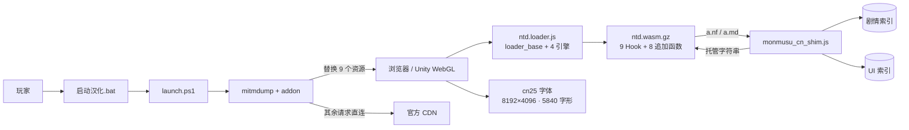

# 架构说明（Monmusu TD Chinese v0.1.0）

面向接手维护的开发者。本文描述**当前代码做什么**。
所有路径相对于仓库根目录。

适配的官方构建：`202611021000`，同时支持两个资源分支——
`/web/arl/202611021000/0/`（DMM）与 `/web/arl/202611021000/1/`（FANZA）。
（Unity 2022.3 WebGL，IL2CPP + Wasm。）

---

## 1. 整体原理

这是一款 DMM 平台的 Unity **WebGL** 游戏。汉化不改游戏程序本体，而是在**网络层**
与 **Wasm 层**两处介入：

1. **网络层**：本地起一个 mitmproxy，把发往 `assets.game-monmusu-td.net` 的
   少数几个资源请求改成本地文件。其余请求原样放行。
2. **Wasm 层**：把官方 `ntd.wasm` 里 9 个函数的开头插入一小段跳转，指向追加在
   模块末尾的桥接函数；桥接函数通过**两个原本就存在、且各自只有一个调用点的
   import**（`a.nf` / `a.md`）回调页面里的 JavaScript，由 JS 决定译文。
3. **字体层**：把中文 SDF 字形预先烘进游戏的 TMP 字体资产（`ntd.data` 内），
   于是 IL2CPP 侧创建的托管字符串可以直接用中文字形渲染。

这三层缺一不可：没有网络层加载不到补丁；没有 Wasm 层拿不到原文串；没有字体层
中文会显示为空白/方块。

```
玩家 → 启动汉化.bat → launch.ps1 → mitmdump(本地代理) ─┬─ 替换资源 → 浏览器
                                                      └─ 其余请求 → 官方 CDN
浏览器 → ntd.loader.js(含 4 个自研引擎) → WebAssembly.instantiate
       → 替换后的 ntd.wasm.gz（9 处 Hook + 8 个追加函数）
       → Hook 触发 → a.nf / a.md → JS 桥 → 剧情/UI 索引 → 返回译文
       → IL2CPP 分配托管字符串 → TMP 用 cn25 字体渲染中文
```



---

## 2. 完整运行流程

### 2.1 启动链

| 步骤 | 代码 | 说明 |
|---|---|---|
| 1 | `启动汉化.bat` | 固定工作目录，调用 `runtime/launch.ps1`；失败时 `pause` 保留窗口。 |
| 2 | `runtime/launch.ps1` → `Read-Config` | 严格解析 `config.ini`，只接受 `[network]` / `[browser]` 的 5 个已知键，未知或重复字段直接报错。 |
| 3 | `Find-Browser` | `chrome`/`edge` 走常见安装路径；`custom` 用 `browser.path`。都找不到就报错。 |
| 4 | 端口占用预检 | 先 `TcpListener` 试绑 `listen_port`，失败提示改配置。 |
| 5 | 启动 `runtime/mitmdump.exe` | 参数：`--listen-host 127.0.0.1 --listen-port <port> --set confdir=<AppRoot>\data --set ssl_insecure=false -s resources\addon_monmusu_cn.py`；配置了 `upstream_port` 时追加 `--mode upstream:http://127.0.0.1:<port>`。子进程与 BAT 控制台同属一个控制台，关窗口即停服务。 |
| 6 | 等待就绪 | 最多 30 s 轮询 TCP 端口，就绪才继续。 |
| 7 | 证书信任 | 读 `data/mitmproxy-ca-cert.cer`，拒绝含私钥的文件；查 `CurrentUser\Root` 是否已有同指纹；没有就调 `certutil -user -addstore Root`，装完再验指纹。失败即中止，不打开游戏。 |
| 8 | 启动浏览器 | `--proxy-server="http://127.0.0.1:<port>" --disable-quic`（`browser.args` 非空时整体替代），游戏 URL `https://play.games.dmm.com/game/monmusutd` 追加在最后。不创建 Profile、不改系统代理、不关浏览器。 |

### 2.2 资源路由

`resources/addon_monmusu_cn.py` 是一个 mitmproxy addon，在 `load()` 时把
`resources/assets.json` 描述的文件**一次性读进内存**，然后只处理
`GET/HEAD` 且 host 匹配的请求。

配置结构（`resources/assets.json`）：

```jsonc
"version": "202611021000",
"version_paths": {                        // 只允许这两个前缀
  "0": "/web/arl/202611021000/0/Build/",
  "1": "/web/arl/202611021000/1/Build/"
},
"assets": [
  { "name": "ntd.wasm.gz", "branch": "0",   "file": "resources/ntd.patched.wasm.gz" },
  { "name": "ntd.wasm.gz", "branch": "1",   "file": "resources/ntd.patched.1.wasm.gz" },
  { "name": "ntd.loader.js", "branch": "any", "file": "resources/ntd.loader.js" },
  ...
]
```

- `name` 必须是**裸文件名**（不允许 `/`），实际 URL = `version_paths[branch] + name`。
- `branch` 为 `0` / `1` / `any`；`any` 会同时注册到两个前缀下。
- `load()` 会校验：每个 `version_paths` 值必须匹配
  `^/web/arl/<12位版本>/<分支>/Build/$`、键与分支号一致、所有前缀的**版本号唯一**。
  任一不满足直接 `ValueError`，不会退化成"随便什么 URL 都替换"。
- `suffix_assets[]`：3 个按**文件名后缀**匹配的 AssetBundle（与分支无关，
  这些 bundle 是内容寻址的，两个平台用同一份）。

命中即返回本地字节，并强制 `Cache-Control: no-store`、`Accept-Ranges: none`
（避免 Range 请求与浏览器缓存导致"改了没生效"）。未命中不碰，直接放行。

被替换的 9 个资源（`/0/` 与 `/1/` 各有一套路径，实际文件 11 个）：

| 资源 | 分支 | 作用 |
|---|---|---|
| `ntd.wasm.gz` | **各自一份** | 打过 9 个 Hook 的 Wasm，`/0/` 与 `/1/` **不是同一个二进制** |
| `ntd.data.gz` | **各自一份** | 官方数据容器 + 烘入的 cn25 字体（各分支保留自己的 `PlayerSettings`） |
| `ntd.loader.js` | 共用 | `loader_base.js` + 4 个引擎拼接后的 Loader（官方 loader 两分支字节相同） |
| `monmusu_cn_story_index.json`(.gz) | 共用 | 剧情译文索引 |
| `monmusu_cn_ui_index.json`(.gz) | 共用 | UI/菜单/任务/角色名索引 |
| `monmusu_cn_translations.json` | 共用 | 序章回退表（索引加载失败时用） |
| `font_ui.bytes`（后缀） | 共用 | UI TMP 字体 bundle（两份额外副本，见 §5） |
| `font_buttons.bytes`（后缀） | 共用 | 对话按钮字体（304 个固定标签字形） |
| `ui_detail.bytes`（后缀） | 共用 | 角色详情 prefab：静态标签译文 + 字体引用 |

### 2.2.1 两个平台到底差在哪（实测，不是假设）

| 对象 | `/0/` DMM | `/1/` FANZA | 结论 |
|---|---|---|---|
| `ntd.wasm.gz`（解压后） | 53,481,333 B | 53,481,733 B | **不同**：+5 个函数、Code +725 B、elem 槽位 +5 → 必须各自打补丁 |
| `global-metadata.dat` | 12,991,256 B | 12,991,692 B | **不同** → `/1/` 的 IL2CPP 元数据必须自己生成 |
| `ntd.data.gz`（解压后 `data.unity3d`） | 7,878 个对象 | 7,878 个对象 | 仅 **1 个** 对象不同：`globalgamemanagers/1` PlayerSettings（880→888 B，商店标识）；其余 7,877 个对象逐字节相同 |
| 原始 TMP 字体 `497`、图集 `6`、`Font` ×2 | — | — | **逐字节相同**（330,284 B / 4096² / 5,794,434 B / 352,462 B） |
| `ntd.loader.js` | — | — | **逐字节相同** |

因此 `/1/` 的 `ntd.data.gz` 不是把 `/0/` 那份直接拷过去，而是
**把中文字体有效载荷移植进 FANZA 自己的容器**（`tools/fonts/graft_branch_data.py`），
只替换 5 个对象 + 17 个材质的 `_TextureWidth/_TextureHeight`，其余原样保留。
在 `/0/` 上执行同一个移植，产物与已实机验证的发行文件**逐字节相同**（含 gzip），
这就是移植正确性的证明。

### 2.3 页面内加载与桥接

`resources/ntd.loader.js` = `loader_base.js` + `\n;\n` + 依次拼接
`monmusu_cn_story_index.js`、`monmusu_cn_ui_index.js`、`monmusu_cn_shim.js`、
`monmusu_cn_bootstrap.js`（见 `tools/build_release.py::build_loader`）。

- `monmusu_cn_story_index.js`：剧情索引的匹配引擎（场景上下文、分段拼接、数字模板）。
- `monmusu_cn_ui_index.js`：UI 索引的匹配引擎（全局表 + 路径表 + `<num>` 模板）。
- `monmusu_cn_shim.js`：桥本身。暴露 `monmusuCnCreateBridge()`，实现两个 import 的协议、
  托管字符串读写、TMP 组件路径重建、运行期字体备选。
- `monmusu_cn_bootstrap.js`：包装 `WebAssembly.instantiate` / `instantiateStreaming`，
  先校验构建签名（import 数 540、`a.nf`/`a.md` 存在等），再等两个索引就绪（最多 12 s），
  然后 `patchImports()` 把 336/228 换成 JS 函数，最后把导出函数表交给桥。

任何一步不匹配：Bootstrap 什么都不做，游戏按原样运行（宁可不汉化，也不破坏启动）。

**分支识别**（`monmusu_cn_bootstrap.js`）：索引 URL 必须跟着当前实际加载的那一支走，
不能固定 `/0/`。`baseFromUrl()` 只认这一种形状
`https://<host>/web/arl/<12位版本>/<0|1>/Build/`，依次尝试：

1. `document.currentScript.src`（bootstrap 就拼在 loader 末尾，最可靠）；
2. 页面上任意 `<script src>`（`currentScript` 在模块/异步场景可能为空）；
3. `location.href` 去掉文件名再补 `Build/`（游戏帧就是 `.../<branch>/index.html`）。

命中后 `base = .../<branch>/Build/`，`CFG.branch` 记录分支；索引请求因此变成
`/1/Build/monmusu_cn_story_index.json` —— 代理按前缀命中同一份文件，所以**不需要两份索引**。
三条都失败时退回 `/0/` 并 `console.warn` 明确告警，而不是静默猜。

---

## 3. Wasm Hook 系统

### 3.1 现有 Hook（声明见 `tools/wasm/hook_targets.json`）

| ID | IL2CPP 方法 | TypeSignature | 补丁逻辑 |
|---|---|---|---|
| H1 | `Utage.TextData$$.ctor` | `viii` | 剧情文本构造：请求译文并替换托管字符串 |
| H2 | `TMPro.TMP_Text$$SetText` | `viiii` | UI 文本主路径 |
| H3 | `TMPro.TMP_Text$$set_text` | `viii` | 虚拟属性 setter（无直接调用点，走 vtable） |
| H4 | `Utage.AdvScenarioData$$Init` | `viii` | 场景解析开始/结束，建立上下文 |
| H5 | `Utage.AdvEngine$$StartScenario` | `viiii` | 播放开始 |
| H6 | `Utage.AdvScenarioPlayer$$StartScenario` | `viiii` | 播放开始 |
| H7 | `Utage.AdvScenarioThread$$StartScenario` | `viiiii` | 播放开始 |
| H8 | `Utage.AdvScenarioPlayer$$EndScenario` | `vii` | 播放结束 |
| H9 | `Utage.AdvCommand$$ParseCellLocalizedText` | `iii` | 表格单元格本地化 |

另有：

- **2 个被复用的 import**：`a.nf`（翻译通道）与 `a.md`（场景上下文通道）。
  官方模块里各只有 1 个直接调用点，所以复用它们不会让任何函数索引位移。
- **1 个字符串分配器**：`il2cpp::vm::String::NewSize(int32)`。由
  `System.String::FastAllocateString`（三指令薄包装 `local.get 0; call X; end`）
  反查得到。补丁需要用真实托管字符串，不能直接改原对象。
- **8 个追加函数** + **3 个导出**（`monmusu_cn_test` / `monmusu_cn_ui_test` /
  `monmusu_cn_alloc`），追加在模块末尾，索引 = `imported + defined + offset`。

补丁只改 **Function / Code / Export** 三个 section；Type / Import / Table / Memory /
Global / Element（函数表）/ Data 逐字节保持不变。

### 3.2 动态定位（已经不依赖固定编号）

`tools/wasm/resolve_targets.py` 的定位链：

```
(方法名, TypeSignature)  →  script.json.ScriptMethod.Address
                        →  Element Table 槽位
                        →  Wasm 函数索引
                        →  Wasm 类型签名比对
                        →  归一化结构指纹 + 补丁位置校验
```

- 唯一命中才继续；零命中 / 多命中 / 签名不符 / 结构不兼容 → 立即失败，不做相似度匹配。
- 结果写入 `build/wasm/resolved_targets.json`，绑定当前输入文件哈希；补丁器只从这里取编号，
  **没有"动态失败就退回旧编号"的分支**。
- `tools/wasm/hook_targets.json` 里的历史槽位仅供参考，不参与定位决策。

### 3.3 元数据从哪来

`tools/wasm/inputs/` 存官方原始 `ntd.wasm`、`ntd.data.gz`、`script.json`、`dump.cs`、
`il2cpp.h`、`slot2name.json`、`global-metadata.dat` 以及 `build_info.json`。

`rebuild_wasm.bat --update <版本>` 会：下载官方资源 → 从 `ntd.data` 抽
`global-metadata.dat` → 调 `tools/il2cppdumper/Il2CppDumper.exe` 重新生成
`script.json`/`dump.cs`/`il2cpp.h` → `symmap.py` 生成 `slot2name.json` →
再走上面的动态定位。目录级原子切换，下载失败不会留下半新半旧。

### 3.4 JS 运行时绑定：也已经由构建生成（阶段三十二）

阶段三十一之前，JS 侧还带着一整张手写的常量表。实测证明它是**错的**：

| 项 | `/0/`（DMM） | `/1/`（FANZA） |
|---|---|---|
| 24 个函数表槽位 | — | **19 个整体 +8** |
| icall 字面量地址 / 缓存指针 | — | 相同（数据段基本一致） |
| TMP 字段偏移 | — | 相同（托管布局没变） |
| import 名 / 序号 / 总数 | `nf`/`md`、336/228、540 | 相同 |

也就是说：FANZA 上旧表的 19 个槽位指向**别的方法**。`call_indirect` 用错槽位
不会干净地失败，会直接跳进另一个函数的函数体。这不是"字体不起作用"，
而是"可能踩内存"。阶段三十二把它改成构建期生成：

```
tools/wasm/runtime_targets.json      声明"要哪个方法"，不写任何编号
        ↓  resolve_runtime.py
script.json  (Name, TypeSignature[, native_params])  → 元素表槽位
data 段      icall 字面量内容（唯一副本 + 被 i32.const 引用）→ 线性地址
包装函数体   i32.const 缓存地址; i32.const 字面量; call → 缓存指针 + resolve_icall 槽位
dump.cs      字段偏移（跳过 static/const）
        ↓
monmusu_cn_runtime_config.js   { branches: { "0": {...}, "1": {...} } }
        ↓  build_release.py 拼接进 resources/ntd.loader.js
bootstrap 按实际分支取条目 → bridge.applyRuntimeConfig(entry)
```

绑定关系是**双向校验**的：

- 配置里写着 `wasm.sha256`；`build_release.py` 解压将要打包的 `ntd.wasm.gz`
  并逐字节比对，不符就拒绝出包（实测拦截过一次伪造哈希）。
- 配置里写着 import 总数；运行时不符就跳过打补丁并说明原因。
- 每个槽位都验过 `(Name, TypeSignature)` 唯一命中 + Wasm 函数类型逐字节相符 +
  shim 的实参数与签名相符；任何一项不成立都记为 `UNRESOLVED` 并让构建失败。

解析报告：`build/wasm/RUNTIME_CONFIG_REPORT.md`（每项给出依据与状态）。

仍然绑定当前版本、且**无法**从构建推导的只剩 4 个 IL2CPP/ABI 常量
（`m_CachedPtr`、`Il2CppClass::name`、`Il2CppString` 的 length/chars 偏移），
标记为 `VERIFIED_STATIC`：它们属于 IL2CPP 运行时布局，不随游戏代码变，
但换了 Unity/IL2CPP 大版本就要重看。

---

## 4. 翻译系统

### 4.1 数据来源

汉化语料来自第三方仓库 `Berumic/MonsterMusumeTDChineseTranslation`
（`translation_source.ini` 配置）。本项目**不生产译文**，只做索引、匹配与打包。

- `target = remote`：每次 `git fetch --depth 1 origin HEAD` + `reset --hard`，
  工作副本放在 `work/translations/src/repo-<url哈希>`。
- `target = local`：只读指定目录，不联网、不 `git pull`。

### 4.2 索引生成

| 生成器 | 产物 | 关键规则 |
|---|---|---|
| `build_story_index.py` | `resources/monmusu_cn_story_index.json` | 场景 ID 解析、同源多译文的场景级消歧、**多段拼接**（`concatenation.scenes`）、命名表 |
| `build_ui_index.py` | `resources/monmusu_cn_ui_index.json` | 全局表 + `pathTables`（叶子名 + 段子序列匹配，路径长度降序）、`<num>` 数字模板、子技能/角色名 |
| `gen_translations.py` | `resources/monmusu_cn_translations.json` | 序章回退表，索引加载失败时的兜底 |

索引结构是**扁平字符串数组 + 配对表**：`strings: [...]` 里源串与译串交错存放，
`global: [[srcIndex, dstIndex], ...]` 给出配对。这样 40 MB 的索引能被 JS 高效加载。

### 4.3 运行时匹配

`Utage` 的剧情文本先经过 `H4`（解析开始）建立场景上下文，`H1` 触发时把原文串交给
`a.nf`；JS 侧按"场景内精确 → 全局精确 → 数字模板 → 已知值短路"的顺序查表，
找不到就返回 0，游戏保留日文。`H9` 处理表格单元格（用 `a.md` 的 `CELL_NAME`/`CELL_SHEET`）。

UI 文本走 `H2`/`H3`：先 `UI_TAG` 探测，命中后按 `m_Text` 内容 + 组件层级路径查
`pathTables`；路径重建失败会**永久关闭**路径规则（只保留全局表），避免拖垮游戏。

### 4.4 静态 prefab 译文

角色详情页有一部分 `TextMeshProUGUI.m_text` 是**序列化在 prefab 里**的，
Unity 在反序列化时直接赋值，游戏从不调用 `SetText`，所以 Wasm Hook 看不到。
这部分由 `tools/prefab/build_ui_detail.py` 在构建期改写 `resources/ui_detail.bytes`：

1. 以 `tools/prefab/assets/ui_detail.pristine.bytes`（官方原始 bundle）为输入；
2. 只替换 `m_text` **在 UI 索引全局表里逐字存在**的字符串（不猜、不模糊匹配）；
   带结尾换行的值会保留换行；
3. 把 4 组详情标签的 `m_fontAsset` 指向 UI 字体变体（pathID 725250001）；
4. 从写出的文件回读校验：CAB 名不变、对象数不变、每条替换可读回、其它对象零改动。

当前结果：197 条文本 + 15 个字体引用，生成文件与已实机验证的发行文件**逐字节相同**
（`e3825ddf…`）。

---

## 5. 字体系统

### 5.1 现状

- 主字体：`sharedassets0.assets` 中的 `FOT-NewRodinProN-EB SDF`（pathID 497），
  图集 `Texture2D` pathID 6，**8192×4096**，Alpha8，**5840 个字形 / 5840 条字符记录**。
- UI 副本：`resources/font_ui.bytes` 里有**两份**字体资产——
  原始副本（5840 字形）与 `monmusu_cn UI Font SDF` 变体（5935 字形 = 5840 + 95 个
  追加 ASCII，供 UI 数字/拉丁字符使用自己的字号度量）。
- 按钮字体：`resources/font_buttons.bytes`，`FOT-KurokaneStd-EBAll SDF`，
  304 个固定标签字形、44pt、1024×1024。**不由译文语料驱动，不参与自动补字。**
- 运行期备选：shim 里 `installFont()` 会把游戏内已有 `Font` 复制成一个 TMP 动态字体资产，
  作为 fallback 链补充；`CFG.uiFontUnify` / `uiFontRefreshAll` 均为 `false`，
  即不替换主字体、不重置已有文本。

### 5.2 编码约定

SDF 取值：`128` = 轮廓线，向内 9 px 到 255，向外 9 px 到 0（`m_AtlasPadding = 9`）。
每个字形的 `GlyphRect` 是**自然墨迹矩形**，外围 9 px 场在矩形之外；
矩形间距 18 px。点大小 48pt。这套参数与阶段二十五在实机验证过的资产一致。

### 5.3 只追加策略（`tools/fonts/add_glyphs.py`）

补字时**不重排图集**：

1. 追加起点 `y0 = max(rect.y + rect.h + ring)`，先断言该行以下像素全为 0；
2. 新字形从 `y0` 向下打包，写入 `[y0, 4096)`；
3. 字体表只在**末尾追加**记录，既有记录的 `m_Index`/度量/`GlyphRect` 原样保留；
4. 构建后断言：图集前 `y0` 行、旧字形块、旧字符表、头部、尾部逐字节不变；
5. 主字体与 `font_ui.bytes` 的两份副本同步追加，各自分配高于自身 `m_Index` 最大值的新索引。

容量：先试 8192×4096；不够则把同一张图集纵向扩到 8192×8192（同一 Texture2D 对象、
同一 PPtr，同步材质 `_TextureWidth/_TextureHeight`）；仍不够则**硬失败**并说明需要第二张
图集（本静态字体资产不支持，必须人工设计）。不丢字、不截断。

### 5.4 自动化

`update_translations.bat` 第 4 步：

1. `tools/translations/target_chars.py` 只收集**译文一侧**实际会显示的字符
   （剧情 `parse/display.global` 的第二元素、`ambiguous` 槽位、`names`、`selfTest`、
   UI 各配对表与 `pathTables`、回退表）。日文原文侧不计入，否则会多要求约 128 个
   从不显示的源汉字。
2. `tools/translations/font_coverage.py` 用 UnityPy 从真实字体字符表读出覆盖集合。
3. 有缺字 → 调 `add_glyphs.py` 补齐 → 回读校验（18 项）→ 断言旧字符一个不少。
4. 无缺字 → 直接复用现有字体，不重建。

字体源是 `tools/fonts/assets/alimama.ttf`（SHA-256 `6433578c…`，与 cn25 构建所用完全一致）。

---

## 6. 资源打包与发行

| 目录 | 职责 | 是否进发行包 |
|---|---|---|
| `resources/` | 生产资源：Wasm、Loader 素材、索引、字体、prefab、代理配置 | 是（白名单） |
| `runtime/` | `mitmdump.exe`、`launch.ps1`、`provenance.json` | 是 |
| `licenses/` | 第三方许可与来源清单 | 是 |
| `tools/` | 构建/定位/补字/审计工具，只给开发者 | 否 |
| `build/` | 构建报告、日志、解析结果（`build/wasm/`、`build/translations/`） | 否 |
| `dist/` | 发行 ZIP + `release_manifest.json` | ZIP 本身即产物 |
| `work/` | 临时工作区（克隆的语料、暂存索引、候选资源） | 否 |
| `docs/` | 设计与审计文档 | 否 |

`tools/build_release.py` 是唯一的打包入口：

1. 用 `loader_base.js` + 4 个引擎重建 `resources/ntd.loader.js`；
2. 校验 `.gz` 与明文一致（索引、Wasm）；
3. 按**显式白名单**收集文件（`启动汉化.bat`、`config.ini`、`README.txt`、`runtime/`、
   `resources/assets.json`、`addon_monmusu_cn.py`、`assets.json` 里列出的资源、`licenses/`）；
4. 拒绝 `data/`、`work/`、`ref/`、`__pycache__`、`profile/` 等目录，拒绝 `.pem/.key/.log`；
5. 校验 `runtime/provenance.json` 里的 mitmdump 哈希；
6. 写 ZIP（`MonmusuTDChinese/` 前缀），再开一次做 CRC、白名单、逐文件 SHA-256 三重校验；
7. 输出 `dist/release_manifest.json`（含每个文件的字节数与 SHA-256）。

---

## 6.1 阶段三十三：运行时自动重建（可选便携工具链）

**启动链不变**：`启动汉化.bat` → `runtime/launch.ps1` → 内置 `mitmdump.exe` +
`resources/addon_monmusu_cn.py`。新增 `--set flow_detail=0 --set termlog_verbosity=error`，
把 mitmproxy 自己的流量日志关掉；汉化器状态改由 `Reporter` 直接 `print` 到 stdout
并写 `logs/monmusu_cn.log`（2 MiB 轮转、含堆栈、脱敏 Token/Cookie/查询串）。
`config.ini` 的 `debug = true` 恢复完整网络日志，不使用 `>nul 2>&1`。

**版本识别**：addon 只处理 `assets.game-monmusu-td.net` 且路径匹配
`^/web/arl/(\d{10,16})/([01])/` 的请求；查询串在进任何日志前被剥离。
`PREFIX_RE` 同为 10–16 位数字 + 分支 `[01]`，并校验「前缀里的分支号 == 键」、
「host == 唯一官方域名」。两个分支允许不同版本号：每个前缀有独立资源表，
`version_paths` / `branch_versions` 为权威来源，绝不跨分支取 Wasm 或 Data。

**后台构建**：`_start_build` 以 `(version, branch)` 为键单飞，`subprocess.Popen` 起
`tools/autobuild/build_worker.py`，`creationflags=CREATE_NO_WINDOW`，
stdout/stderr 写入 `work/autobuild/<版本>-<分支>/worker-<n>.log`。
`_wait` 线程 `wait()` 后读 `result.json`，并在**该后台线程**里完成资源重载
（`_read_payload` 会读约 150 MiB，不能放在 request 回调里阻塞事件循环），
再通过 `queue.Queue` 把结果交给 `_drain()` 在事件循环上做纯内存替换。
失败后 300 秒冷却、最多 2 次尝试；`done()` 在退出时终止残留子进程。

**构建隔离（三重）**：worker 在 `import official_inputs` **之前**设置
`MONMUSU_AUTO_BUILD` / `MONMUSU_INPUTS_ROOT` / `MONMUSU_BUILD_ROOT`
（该模块在 import 期解析路径，写反顺序会覆盖开发者已验证的 `tools/wasm/inputs/`）；
`auto_build_guard()` 二次断言两个重定向都生效；`rebuild_wasm.py`、
`resolve_runtime.py`、`verify_patch.py`、`test_reorder.py` 的 `BUILD`/`OUT` 也读取
`MONMUSU_BUILD_ROOT`，所有中间文件落在 `work/autobuild/<job>/`。
IL2CPP dump 的 ~130 个 DummyDll 不再在构建中途 `rmtree`，改用带 pid 时间戳的
独立目录，既不触发批量删除策略，也不会被 `atomic_switch` 带进 `inputs/`。

**门禁**：9 Hook `RESOLVED` + `compat.publishable` + 配置与 Wasm SHA-256 绑定 +
gzip/明文一致 + `graft_branch_data.py` 的对象 SHA-256 基线 +
`test_reorder.py` 结构测试。激活时 `patch_loader()` **只替换
`resources/ntd.loader.js` 里 `RUNTIME_JSON_BEGIN/END` 之间的 JSON 块**——
因为 `loader_base.js` 和五个引擎源码是开发者文件，故意不放进玩家 ZIP。
`verify_bindings()` 从实际落盘的字节重新校验两个分支，任一失败整体回滚。
不改基线、不跳过 `UNRESOLVED`、不启用哈希不一致的配置。

**便携工具链**：`runtime/toolchain.json` 是能力开关，缺省即「自动构建禁用 +
明确提示 + 官方直通」。`tools/autobuild/build_toolchain.py` 从开发者机器裁剪
CPython（74 MiB，含 UnityPy 依赖闭包）、最小 .NET 8 运行时（71 MiB）、
Il2CppDumper（MIT），并在 PATH 只剩 System32、清空所有 PYTHON*/DOTNET* 变量
的环境里自检。`build_release.py --with-toolchain` 用严格白名单打包
（1660 文件 / 207 MiB，标准版 45 文件 / 151 MiB）。
`curl.exe` 用 Windows 自带的；Node.js 不需要（`WebAssembly.validate` 缺失时
`verify_patch.py` 记为 SKIPPED，不作为门禁）。

**三级验证状态，不得混淆**：`构建完成` → `静态校验通过 (static)` →
`浏览器实机验证通过`。自动构建结果永远标 `static`，addon 也以此文案提示。
干净 Windows 虚拟机（完全无开发工具链）与浏览器实机均为 `NOT RUN`。

---

## 7. 已知限制

1. **版本绑定**：`202611021000`。`resources/assets.json` 的 `version_paths`（两个分支前缀）
   在开发流程里仍是手写的；官方换版本后资源一个都不会被替换，**游戏会正常跑，但全是日文，
   且没有任何报错**。阶段三十三起，自动更新版由 addon 检测未知版本并触发本地构建，
   成功后 `build_worker.py::activate()` 自动改写 `version_paths`（并维护
   `branch_versions`；两分支版本不同时旧标量 `version` 置 `null`）。
   标准版没有构建运行时，未知版本**明确提示 + 直通**，不再完全静默。
   （Bootstrap 已不再自带版本号：它从生成的运行时配置里读 `game_build`。）
2. **JS 运行时绑定**：已从手写常量改为构建期生成（见 §3.4）。**但"能重新定位"
   不等于"语义一定没变"**：如果官方改的是 TMP 字段含义、import 语义或函数实现，
   定位仍然会成功而行为可能不同。因此新版必须做浏览器验收，见 §7.6。
   剩下的 4 个 IL2CPP/ABI 常量是 `VERIFIED_STATIC`，换 Unity 大版本需重看。
3. **静态 prefab**：`ui_detail.bytes` 只能从**当前官方原始 bundle** 重建；
   若官方更新了该 bundle，`tools/prefab/assets/ui_detail.pristine.bytes` 必须换成新的，
   否则重建会因"匹配不到译文/字体引用不符"而失败——此时流程会保留旧文件并给出 WARNING。
4. **按钮字体**：304 个固定标签字形，不由语料驱动。若按钮文案出现新字，需要单独补。
5. **Wasm 结构变化**：官方若做 LTO 内联或大幅优化，结构指纹会不匹配 → 构建停止并要求
   人工复核后重新签核基线（`--emit-baseline`），**不会**猜一个近似函数。
6. **浏览器实机验证**：`NOT RUN`。所有自动化结论只覆盖资源层与数据层。
7. **自动更新版仍非完全无人值守**：静态门禁证明的是结构一致，不是游戏语义正确。
   官方若改了字体/Data 容器对象、静态 prefab 哈希、IL2CPP 字段布局或函数指纹，
   构建会**明确失败并保持直通**，需要维护者人工介入（见 `USAGE.md` §5.4）。
   自动构建成功也不代表通过浏览器验收，结果一律标 `static`。
   标准版根本不含构建运行时，未知版本只能等维护者更新。
8. **自动兼容的边界**：能自动适配的是"可识别的编译偏移变化"——函数重排、索引位移、
   数据地址变化、新增无关函数。不能自动适配的是：目标方法消失/被内联、import 协议改变、
   字段语义变化、Unity/IL2CPP 大版本升级。后几种会**明确失败**（`UNRESOLVED`），
   不会静默用旧值继续打补丁。自动构建通过**也不等于**可以发布：翻译覆盖、字体字形、
   静态 prefab、资源路径都要各自验证，最后由人做浏览器验收。
